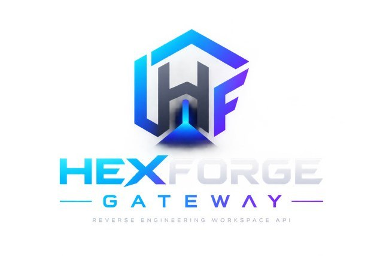

# HexForge Gateway

<div align="center">
  
</div>

<div align="center">
  <a href="https://github.com/boy-offi9-inc/hexforge-gateway/actions/workflows/ci.yml"></a>
  <a href="LICENSE"></a>
  <a href="https://nodejs.org">= 20"></a>
  <a href="https://www.typescriptlang.org"></a>
  <a href="https://fastify.dev"></a>
  <br>
  <a href="docs/SETUP.md"></a>
  
  <a href="CONTRIBUTING.md"></a>
</div>

---

**HexForge Gateway is an AI-assisted APK reverse-engineering workspace API.**
It dispatches tasks to MCP agents (jadx, apktool, apksigner, adb, frida, ghidra,
filesystem, MT Manager's APK MCP, AI providers) and streams updates over
WebSocket. It runs entirely on-device (Termux + MT Manager on Android) or on
a normal PC — no cloud required.

## What makes it different

HexForge treats every external tool as a **replaceable backend** behind one
**capability contract** — if jadx disappears tomorrow, `java.decompile`
keeps working through another adapter. On top of the raw tooling sits an
evidence pipeline: a **typed knowledge graph** of classes, packages and
secret candidates merged by derived ids so re-analysis never duplicates;
**findings** that carry a claim, a confidence and evidence citing real
artifacts; and a **verifier** that re-checks every citation against the
files on disk, exportable as JSON / Markdown / SARIF. Secret scanning is
**redaction by design** — fingerprints and previews, never the value
itself. And the whole thing is **local-first**: the full pipeline runs on an
Android phone via Termux, a PC, or a VPS, with no cloud dependency.

## Getting started

```bash
npm install
cp .env.example .env
npm run dev
```

The Gateway starts on `http://localhost:8080` and prints a banner with your
workspaces and copy-pasteable commands. `GET /` returns the same as JSON —
the quickest way to see what's here.

## How it fits together

```
HexForge Gateway
├── Clients            hf CLI · MCP clients (Claude / Cursor) · REST / WS
├── API layer          Fastify routes · opt-in auth · Event Bus
├── Engines            Job Engine (retry + timeout) · Workflow Engine (parallel + resume)
├── MCP agents         jadx · apktool · apksigner · apkid · triage · apkmcp · ghidra
│                      filesystem · adb · frida · ai
├── Backend tools      jadx · apktool · apksigner · apkid · adb · frida on PATH
│                      MT Manager's APK MCP service · 9 AI providers
└── Evidence layer     Artifacts (typed + provenance) · Knowledge graph
                       (typed entities + edges) · Findings (claim + evidence) · Verifier
```

A request enters through the API layer, becomes a task, and the task
orchestrator hands it to the agent that provides the requested capability.
Agents talk to real backend tools; every finished task's output is recorded
as an artifact with tool-version provenance; artifacts feed the knowledge
graph and findings; findings get re-verified on demand. Modules communicate
through the Event Bus, not direct calls.

## Core endpoints

Request/response shapes are in the linked docs:

- `GET /` — live cheat sheet · `GET /health` — service + config status
- `POST /workspaces` / `GET /workspaces[/:id]` / `PUT /workspaces/by-name/:name` (idempotent get-or-create)
- `POST /workspaces/:id/tasks` — dispatch to an MCP agent, fire-and-forget; poll or watch `/ws` ([AGENTS](docs/AGENTS.md))
- `POST /workspaces/:id/jobs` / `/workflows` / `/knowledge` ([ARCHITECTURE](docs/ARCHITECTURE.md))
- `GET /workspaces/:id/inbox` — APKs dropped into `APK_INBOX_DIR`, if configured, and auto-claimed into this workspace ([INBOX](docs/INBOX.md))
- `POST|GET /workspaces/:id/chat` ([AI](docs/AI.md))
- `GET /plugins` ([PLUGINS](docs/PLUGINS.md))
- `GET /capabilities` — what the Gateway can do and which agents provide it ([AGENTS](docs/AGENTS.md#capabilities))
- `GET /workspaces/:id/artifacts` / `GET /artifacts/:id` — directories and files finished tasks produced, with the run that made them ([ARCHITECTURE](docs/ARCHITECTURE.md#artifacts))
- `POST|GET /workspaces/:id/findings` (filter by `status` or a cited `entityId`), `GET|PATCH /findings/:id`, `GET /findings/:id/verification` — claims with evidence checked against real artifacts and graph entities, and re-checked against the cited files ([ARCHITECTURE](docs/ARCHITECTURE.md#findings))
- `GET /workspaces/:id/report?format=json|markdown|sarif` — a findings report with each piece of evidence re-checked ([ARCHITECTURE](docs/ARCHITECTURE.md#findings-report))
- `POST|GET /workspaces/:id/graph/entities`, `GET /graph/entities/:id`, `POST|GET /workspaces/:id/graph/edges` — typed entities and relationships observed about the target ([ARCHITECTURE](docs/ARCHITECTURE.md#knowledge-graph))
- `WS /ws` — real-time `task:update`, `job:update`, `workflow:update`, `knowledge:entry_created`, `workspace:status_changed` for every workspace
- `WS /ws/workspaces/:id` — same events, filtered to one workspace

## Secret intelligence

`scan-secrets` runs a 24-detector registry (cloud keys, tokens, JWTs, private
keys, webhook URLs, high-entropy shapes) and scores every hit into a
**redacted candidate** — detector, confidence from entropy / context keywords
/ placeholder shapes, SHA-256 fingerprint for dedupe. The secret value itself
is never stored, not in the result, not in the artifact, not in the graph.
Candidates land in the knowledge graph as typed entities. ([AGENTS](docs/AGENTS.md))

## Triage front door

One fingerprint-first assessment before paying for a full decompile: APKiD
packer/compiler fingerprints, manifest analysis (permissions, exported
components), native library inventory per ABI, and **Kotlin name recovery** —
R8/ProGuard-renamed classes keep their original names in `@kotlin.Metadata`,
so obfuscated classes get recovered statically. ([AGENTS](docs/AGENTS.md#triage))

## Stack

Node.js 22+ / TypeScript, Fastify (+ `@fastify/websocket`), Zod. Storage is
local files by default; Supabase (`STORAGE_BACKEND=supabase`) or any Postgres
- Neon included (`STORAGE_BACKEND=postgres` + `DATABASE_URL`) is opt-in. Auth
is an opt-in API key check, off by default (`AUTH_ENABLED=false`). `npm test`
runs the Vitest unit suite (600+ tests, no live instance needed);
`scripts/smoke-test.sh` covers end-to-end happy paths against a running
Gateway — see `tests/README.md` for the split.

## Documentation

| Doc | Covers |
|---|---|
| [`docs/SETUP.md`](docs/SETUP.md) | Requirements, auth, storage backend, running on PC and Android/Termux |
| [`docs/ARCHITECTURE.md`](docs/ARCHITECTURE.md) | Event Bus, Job Engine, Workflow Engine, Knowledge Engine |
| [`docs/AGENTS.md`](docs/AGENTS.md) | Every MCP agent — operations and examples |
| [`docs/APK_MODIFICATION.md`](docs/APK_MODIFICATION.md) | Decode, patch, rebuild, sign and install an APK — step by step |
| [`docs/EVIDENCE.md`](docs/EVIDENCE.md) | From a task's output to a finding with evidence, and checking it — step by step |
| [`docs/AI.md`](docs/AI.md) | The AI provider layer (9 built-in providers, custom providers file), the `ai` agent, Terminal chat |
| [`docs/MCP_SERVER.md`](docs/MCP_SERVER.md) | Registering HexForge's agents as native tools in Claude Desktop/Code/Cursor |
| [`docs/PLUGINS.md`](docs/PLUGINS.md) | The Plugin System — contract, loader, reference plugins |
| [`docs/CLI.md`](docs/CLI.md) | The `hf` CLI (`scripts/hf.sh`) and `scripts/smoke-test.sh` |
| [`docs/MT_MANAGER.md`](docs/MT_MANAGER.md) | MT Manager's APK MCP setup, with screenshots and troubleshooting |
| [`docs/PROJECT_STRUCTURE.md`](docs/PROJECT_STRUCTURE.md) | Repo layout and how the pieces talk |
| [`docs/ROADMAP.md`](docs/ROADMAP.md) | What's done and what's still open |

## Contributing

Run `npm run typecheck && npm run build && ./scripts/smoke-test.sh` before a
PR — see [`CONTRIBUTING.md`](CONTRIBUTING.md). Issues and PRs welcome.

