# Project structure

Where things live, and how a request moves through them.

## 🗂️ Repo layout

```
src/
├── index.ts                          # entrypoint - startup banner, then app.listen()
│
├── core/                             # ── app assembly & cross-cutting concerns
│   ├── config.ts                     #   env validation (zod)
│   ├── auth.ts                       #   opt-in API key check (off by default)
│   ├── server.ts                     #   fastify app assembly, route registration
│   ├── websocket.ts                  #   real-time update broadcasting
│   ├── console-ui.ts                 #   the Gateway's own terminal output: startup banner, one-line request logs, styled notices
│   └── types.ts                      #   shared TypeScript types
│
├── api/v1/                           # ── HTTP surface
│   ├── health.routes.ts              #   GET /health
│   ├── root.routes.ts                #   GET / (live cheat sheet)
│   ├── workspace.routes.ts           #   workspace CRUD + inbox listing
│   ├── job.routes.ts                 #   job dispatch + status
│   ├── workflow.routes.ts            #   workflow dispatch, resume, status
│   ├── knowledge.routes.ts           #   knowledge entries + the /chat routes
│   ├── artifact.routes.ts            #   artifact listing + fetch
│   ├── finding.routes.ts             #   findings + verification
│   ├── graph.routes.ts               #   graph entities + edges
│   ├── report.routes.ts              #   workspace report (JSON / Markdown / SARIF)
│   ├── capability.routes.ts          #   GET /capabilities
│   └── plugin.routes.ts              #   plugin introspection
│
├── modules/                          # ── the engines & domain logic
│   ├── workspace/
│   │   └── workspace.service.ts      #   workspace CRUD (local storage or Supabase)
│   ├── mcp/
│   │   ├── orchestrator.ts           #   task dispatch + agent handler registry
│   │   └── agents/                   #   jadx · apktool · apksigner · apkid · triage · apkmcp · ai · filesystem · adb · frida
│   │       ├── shared/exec-error.ts  #     common error shaping for spawned tools
│   │       ├── secret-detectors.ts   #     24-detector registry + confidence scoring (scan-secrets)
│   │       ├── triage.agent.ts       #     fingerprint-first assessment + Kotlin name recovery
│   │       └── filesystem.search.worker.ts  # worker thread for regex search (ReDoS timeout)
│   ├── jobs/
│   │   └── job-engine.ts             #   retryable wrapper around a single MCP task dispatch
│   ├── workflow/
│   │   └── workflow-engine.ts        #   parallel step groups + resume of a failed run
│   ├── knowledge/
│   │   ├── knowledge.service.ts      #   KnowledgeEntry CRUD
│   │   └── knowledge-indexer.ts      #   auto-creates a report entry when a workflow finishes
│   ├── ai/
│   │   └── ai.service.ts             #   summarizeEntry() and chat() - ties the AI provider to the Knowledge Engine
│   └── inbox/
│       └── inbox-watcher.ts          #   "PC-side APK MCP" - poll-based watched-folder that claims dropped .apk files into their own workspace
│
├── graph/                            # ── typed knowledge graph
│   ├── graph.service.ts              #   entities + edges, merged by derived ids
│   ├── java-indexer.ts               #   decompiled sources → package/class entities + contains edges
│   ├── smali-indexer.ts              #   decoded smali → same entities, merged with the Java side
│   └── secret-indexer.ts             #   secret-scan artifacts → redacted secret-candidate entities
│
├── artifacts/                        # ── tracked task outputs
│   ├── artifact.service.ts           #   record / list / fetch
│   ├── recorder.ts                   #   subscribes to finished tasks, records declared outputs
│   └── types.ts                      #   Artifact + provenance shapes
│
├── findings/                         # ── claims + evidence
│   ├── finding.service.ts            #   findings with validated evidence
│   ├── verifier.ts                   #   re-checks cited locations against artifact files
│   └── types.ts                      #   Finding / Evidence / verification shapes
│
├── report/                           # ── workspace report as JSON / Markdown / SARIF 2.1.0
│
├── providers/                        # ── external world abstractions
│   ├── supabase.client.ts            #   provider-layer abstraction over Supabase
│   ├── ai.provider.ts                #   provider-layer abstraction over 9 AI vendors
│   └── local-storage.provider.ts     #   JSON-file storage, primary in local mode / fallback in supabase mode
│
├── mcp-server/                       # ── HexForge as an MCP server
│   ├── protocol.ts                   #   transport-agnostic JSON-RPC dispatch + tool execution, shared by both transports
│   ├── index.ts                      #   stdio transport - newline-delimited JSON-RPC framing
│   ├── http.ts                       #   Streamable HTTP transport - POST /mcp
│   ├── tools.ts                      #   the 30 MCP tools exposed, table-driven
│   └── gateway-client.ts             #   thin HTTP client to an already-running Gateway
│
├── plugins/                          # ── extensions without touching the core
│   ├── types.ts                      #   PluginContext / HexForgePlugin contract
│   ├── loader.ts                     #   discovers + safely loads plugins/installed/*
│   └── installed/
│       ├── example-strings/          #   reference plugin - new MCP agent pattern
│       └── webhook-notifier/         #   reference plugin - event-only pattern
│
└── events/
    ├── event-bus.ts                  #   typed pub/sub singleton
    └── types.ts                      #   EventMap - every event + payload shape

scripts/
├── hf.sh                             # launcher for the hf CLI (finds Node, runs hf/cli.mjs)
├── hf/
│   ├── cli.mjs                       # hf commands, live job/workflow follow views, chat REPL
│   ├── ui.mjs                        # pure terminal styling - brand-blue palette, boxes, cards, wrapping, markdown
│   └── client.mjs                    # fetch wrapper with typed errors, ~/.hexforge state file
└── smoke-test.sh                     # automated end-to-end test

docs/                                 # SETUP · ARCHITECTURE · AGENTS · APK_MODIFICATION · EVIDENCE · AI
                                      # MCP_SERVER · PLUGINS · CLI · MT_MANAGER · MT_TOOLS · INBOX
                                      # PROJECT_STRUCTURE · ROADMAP · images/
.github/
├── workflows/
│   ├── ci.yml                        # typecheck + build + real smoke-test.sh run + MCP handshake check
│   └── release.yml                   # publishes a GitHub Release on a package.json version bump
├── ISSUE_TEMPLATE/                   # bug report / feature request templates
└── dependabot.yml

Dockerfile                            # container image for MCP introspection (Glama)
glama.json                            # Glama directory listing config
supabase.schema.sql                   # tables for the optional Supabase backend
.env.example                          # every config variable, documented
LICENSE                               # MIT
```

## 🔄 How a request moves

```mermaid
flowchart LR
    REQ["POST /workspaces/:id/tasks<br/>or /jobs or /workflows"] --> ROUTES["API v1 routes"]
    ROUTES --> JOB["Job Engine<br/>(retry + timeout)"]
    ROUTES -->|"workflow steps<br/>(parallel groups,<br/>resume)"| JOB
    JOB --> ORCH["Task Orchestrator"]
    ORCH --> AGENT["Agent handler<br/>(jadx / apktool / adb / …)"]
    AGENT --> TOOL["Backend tool<br/>or device or MT Manager"]
    AGENT -->|"result"| OUT["withSavedOutput<br/>workspace file"]
    OUT -->|"outputPath"| REC["Artifact recorder"]
    REC -->|"artifact.created"| ART["Artifact"]
    ART --> JAVA["java-indexer"]
    ART --> SMALI["smali-indexer"]
    ART --> SECRET["secret-indexer"]
    JAVA & SMALI & SECRET --> GRAPH["Knowledge Graph<br/>entities + edges"]
    GRAPH --> FIND["Findings<br/>(validated evidence)"]
    ART --> FIND
    FIND --> VER["Verifier"]
    ORCH -.->|"task:update<br/>job:update<br/>workflow:update"| WS["WebSocket /ws"]
    WF2["Workflow finished"] -.->|"workflow.completed"| KI["Knowledge indexer"]
    KI --> KE["Knowledge entry"]
```



## 🧵 How the pieces talk

Routes call into `modules/*` services directly (simple, synchronous
calls); those services publish to the Event Bus for anything
lifecycle-related, and things like the WebSocket gateway, the artifact
recorder, the graph indexers and the Knowledge Indexer subscribe to
those events rather than being called directly. See
[`ARCHITECTURE.md`](ARCHITECTURE.md) for the engines and the full event
table.
